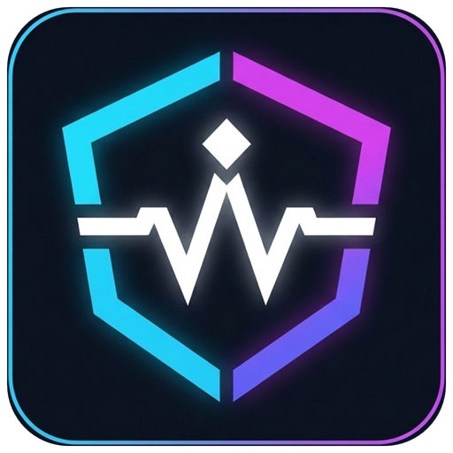
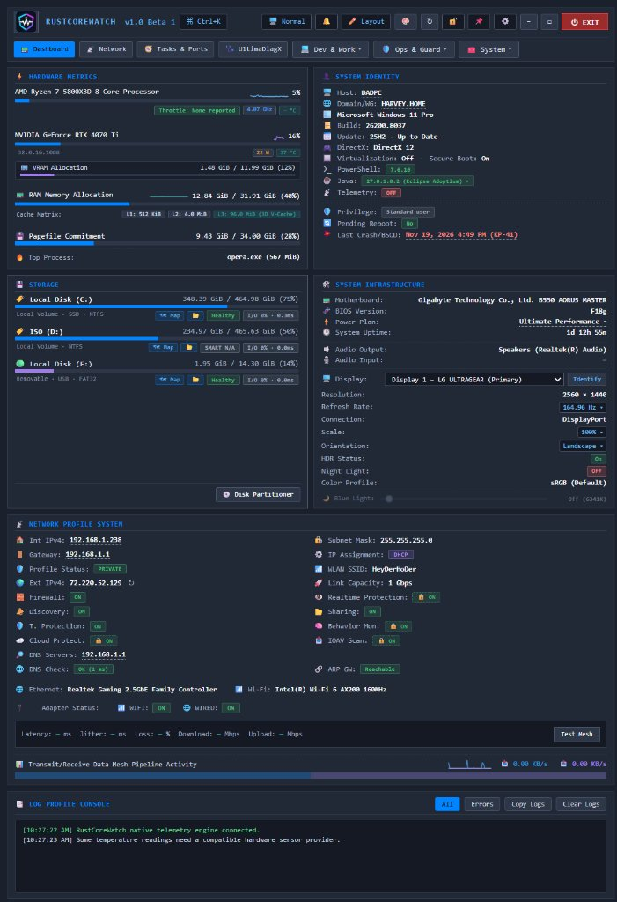

<div align="center">



# RustCoreWatch (CoreWatch Host Engine)

**Native Windows 10/11 telemetry dashboard, hardware & RGB lighting control deck, diagnostics lab, operations & protection hub, and developer workbench.**

Built in **native Rust**, **Tauri v2**, **WebView2**, and direct **Win32 / USB HID / NVAPI / PawnIO SMBus / SCM / Crypt32 / IP Helper / WinHTTP / DPAPI** APIs — zero PowerShell host required, zero background console window.

[](https://github.com/jonathan820612/CoreWatch-Host-Engine/releases)
[](Cargo.toml)
[-0078D6?style=flat-square)](https://github.com/jonathan820612/CoreWatch-Host-Engine/releases)

<br />



</div>

> [!IMPORTANT]
> **RustCoreWatch is now the active flagship edition of CoreWatch.**
> The original PowerShell + WinForms edition reached **End-of-Life at [`v0.9.3`](https://github.com/jonathan820612/CoreWatch-Host-Engine/releases/tag/v0.9.3)** and is archived under [`legacy-powershell/`](legacy-powershell/) in **maintenance mode (bug fixes only — no new features)**.

---
Hello and thanks for checking out my project! My name is Jonathan.
This app is something I made from over a long time working with Powershell scripting and using them for work and home. 
I wanted to do something more original with them so I started using AI to help develop something more user friendly organized and with lots of eye candy!
The app is designed to be very modular and you can pick with modules you want or don't want. You can install everything and hide what you don't want later, or remove it completely. 
Whoever decides to give this app a try please be brutally honest and report anything that is broken, I will fix it ASAP. 
I want a lot of feedback so I can refine my app for any user type out there. 

## Quick Start & Building RustCoreWatch

### Prerequisites
- **Windows 10 / 11 (x64)** with Microsoft Edge WebView2 Evergreen Runtime (preinstalled on Windows 11)
- **Rust MSVC toolchain** (`rustup`) + **Visual Studio C++ Build Tools** (*Desktop development with C++*)
- Optional: **PawnIO signed driver** (`winget install namazso.PawnIO`) for Ryzen/Intel CPU die temperatures and SMBus DRAM RGB control (requires Administrator)

### Build Modular Beta Installer & Portable Package

```powershell
# Runs Clippy + unit tests + optimized Release build + stages optional CPU/thermal sensor helper,
# renders high-DPI Light/Dark wizard artwork, and compiles:
#   - dist\RustCoreWatch-1.0.0-beta.1-Setup.exe     (Modular Windows 11 Dark/Light Installer)
#   - dist\RustCoreWatch-1.0.0-beta.1-Portable.zip  (Self-contained portable package)
#   - dist\RustCoreWatch-1.0.0-beta.1-SHA256SUMS.txt
.\build\Build-Beta.ps1
.\build\Build-Beta.ps1 -Bump beta   # Bump version (beta|patch|minor|major) across Cargo.toml, Cargo.lock & tauri.conf.json
```

### Build & Launch Optimized Release (`RustCoreWatch.exe`)

```powershell
# 1. Build optimized Release binary (locked dependencies)
cargo build --locked --release

# 2. Optional: stage the LibreHardwareMonitor sensor helper beside the binary
.\prepare-sensors.ps1 -Release

# 3. Launch RustCoreWatch (native GUI subsystem — zero console window)
.\target\release\RustCoreWatch.exe
```

> [!TIP]
> **Low-Memory Mode** can be enabled in **Settings → General** (or during Setup) to disable Chromium's WebView2 GPU compositor process, cutting committed RAM by ~58% (~177 MB Private RAM vs. ~334 MB with GPU acceleration enabled).

### Development Build & Verification

```powershell
.\prepare-sensors.ps1
cargo clippy --all-targets --locked -- -D warnings
cargo test --locked
cargo build --locked

# CLI verification utilities (still print cleanly in terminals):
.\target\release\RustCoreWatch.exe --smoke-test | Out-Host
.\target\release\RustCoreWatch.exe --smoke-test --narrow | Out-Host
.\target\release\RustCoreWatch.exe --rgb-test "#00b4ff" | Out-Host
.\target\release\RustCoreWatch.exe --snapshot | Out-Host
.\target\release\RustCoreWatch.exe --diagnostics 24 | Out-Host
```

---

## Key Features (Dashboard + 25 Native Rust Modules + Floating Disk Partitioner)

### Live Telemetry Dashboard (`📟 Dashboard`)
- **Hardware Metrics**: Real-time CPU load, boost clock, thermal/power throttle badge, 20s inline SVG sparklines, L1/L2/L3 Cache Matrix (including AMD 3D V-Cache), GPU load/power/temp/VRAM, RAM & Pagefile commitment, and live Top Resource Consumer inspector.
- **System Identity & Infrastructure**: Click-to-copy Hostname & Domain/Workgroup, Windows edition & UBR, genuine OS **Pending Reboot** registry detection, smart MSI/MSIX PowerShell 7 version/update tracker, inline Java runtime dropdown, Windows Telemetry toggle, 1-click Admin/User relaunch, last BSOD/KP-41 crash jump, Motherboard/BIOS, inline Power Plan dropdown, Uptime, Audio devices, and multi-monitor Display controls (**Identify**, inline **Refresh Rate** / **DPI Scale** / **Orientation** dropdowns, **HDR**, **Night Light** + warmth slider).
- **Network Profile, Storage & Live System Console**: Live IPv4/CIDR/Gateway/External IPv4, click-to-copy active MAC address, WLAN SSID, Firewall & Tamper-aware Windows Defender status pills (`🔒`), DNS preset switcher, ARP gateway reachability, Cloudflare speed/jitter/loss test, live dual-direction RX/TX throughput sparkline, Storage volumes with SMART health/wear/temp/I/O, 1-click **Disk Map** jump, floating **Disk Partitioner**, and a **Log Profile Console** with a live **Live System Console Mode** toggle (streaming Windows Event Logs, process launches/exits, SCM service transitions & volume mounts in real time).
- **Modern Shell & Personalization**:
  - **4-Step First-Launch Setup Wizard**: Live-preview onboarding for Themes/Colors, Dashboard Layout, Telemetry, Admin vs. Standard User Launch Mode, and visible Tabs (plus 1-click legacy PowerShell import).
  - **Admin vs. Standard User Launch Mode**: Selectable in Setup and Settings → General with automatic elevated Task Scheduler logon sync (`RustCoreWatch_AutoStart`) and 1-click restart in either privilege mode.
  - **Console-Free Native Launch & Single-Instance Guard**: Launches cleanly with `#![windows_subsystem = "windows"]` and restores/focuses any existing (or tray-hidden) window on relaunch.
  - **`⌘ Ctrl+K` Command Palette (55+ Actions)**, **4-Size Font Scaling**, **Theme Studio 2.0**, **Movable Telemetry Dock 2.0**, **3-State Window Lock**, **Always on Top (`📌`)**, and **Tray Watchdog**.

### 🌡️ Thermal & Cooling Lab (System Temps, AIO/Pump, Fan Control & Bearing Health)
- **Full-System Telemetry**: Live CPU package/CCD/cores, GPU Core/Hot Spot/VRAM Junction, Motherboard VRM/PCH/System, AIO Liquid/Coolant & Flow Rate, NVMe/SATA SMART drives, and DDR DIMM temperatures with session Min/Max and sparklines.
- **Fan & AIO Pump Control**: Hardware **Auto (BIOS)**, **Manual PWM sliders**, interactive **Custom Temp-to-PWM Curves** with hysteresis, Quick Cooling Presets (*Silent / Balanced / Performance / Max 100%*), enforced **35% AIO Pump safety floor**, and automatic restore-to-Auto on app exit.
- **Mechanical & Hydraulic Failure Diagnostics**: Automated detection for **Stalled / 0-RPM Fans** (smartly excluding GPU 0-dB idle mode), **Bearing Drag / End-of-Life RPM Deficit** (compared against learned persistent RPM-vs-PWM baselines), **Bearing Wobble / Tachometer Jitter**, **AIO Pump Cavitation / Low-RPM / Heat-Soak Delta**, **Unresponsive PWM Headers**, plus a 1-click **Fan & Pump Health Stress Check**.

### 🌈 RGB Lighting Studio (RustCoreWatch Exclusive — Zero OpenRGB Required)
Standalone native Rust hardware lighting engine with parallel bus discovery, auto-restore on launch, per-device pin/override, Smart Alert critical-flash pulses, live CPU/GPU thermal reactive gradients, System Profile auto-sync, and a **Hardware Diagnostics & Live Readback** drawer:
- **Direct Win32 USB HID (`src/rgb_hid.rs`)**: Gigabyte RGB Fusion 2.0 motherboards & ARGB headers (ITE IT5702/IT5711/IT8297 with GRB calibration) and Razer Chroma keyboards & mice (91-byte extended matrix HID with safe `NOSTORE` streaming).
- **Direct NVIDIA NVAPI I2C (`src/rgb_nvapi.rs`)**: ASUS Aura / ENE 6K582 RTX GPUs directly via `nvapi64.dll` I2C port 1.
- **Direct PawnIO SMBus DRAM (`src/rgb_smbus.rs`)**: Corsair Vengeance/Dominator/DDR5 and G.Skill/TeamGroup ENE Aura RAM via signed PawnIO SMBus modules (Administrator).
- **Windows 11 Dynamic Lighting (`LampArray`)** + optional collapsed OpenRGB SDK bridge (`127.0.0.1:6742`).

### Top-Level Management & Diagnostic Suites
- **📡 Network Manager**: Native `GetIpForwardTable2` / `GetIpNetTable2` routes & ARP tables with OUI vendor hints, static IP/DHCP/DNS provisioning, adapter controls, Ping (with TTL), parallel reverse-DNS Traceroute, structured DNS lookup (`A`/`AAAA`/`MX`/`TXT`/`SRV`/`ANY`), and TCP Port Checker.
- **🧭 Tasks & Ports**: Native Win32 SCM service enumeration (~15 ms), live process CPU/RAM/handles, TCP/UDP sockets with port service hints, PID cross-linking, and sortable columns.
- **🩺 UltimaDiagX 2.0**: Parallel 10-channel Event Log scan, **8-Subsystem Health Matrix**, **8 automated Root-Cause Findings**, **45+ Event ID & 40+ Stop Code / NTSTATUS / HRESULT KB** with `ntdll.dll` fallback, pure-Rust **BSOD `.dmp` header parser**, 24-bucket timeline histogram, `±5m Nearby` correlation filter, and epoch-aware Mark Solved persistence.

### Grouped Module Suites (`💻 Dev & Work ▾`, `🛡️ Ops & Guard ▾`, `🧰 System ▾`)
- **💻 Dev & Work**: **GitHub Manager** (parallel scan, ahead/behind, `Pull All`, native WinHTTP releases), **Jira Manager** (DPAPI-encrypted tokens, WinHTTP REST v3/v2, JQL presets, live Issue Inspector & Status Transitions), **WSL Manager** (`vmmem` RAM, VHDX sizes, Explorer `\\wsl.localhost`, WSL 1↔2, non-destructive 12-key `.wslconfig` merge), **Docker & Dev Services** (containers, images, native SCM dev services), **SSH & Certificates** (`~/.ssh/config` + `ProxyJump` + ED25519 keygen + native `crypt32.dll` cert auditor ~1 ms), **Multi-PC / Homelab Monitor** (parallel HTTP/HTTPS/ICMP/TCP probes + 1-click SSH/RDP/Web launchers).
- **🛡️ Ops & Guard**: **Smart Alerts & Watchdog** (tray watchdog, mute toggle, RGB alert flash), **Unified Update Center** (parallel WinGet/PS7/CoreWatch checks + batch upgrades + pin/ignore), **System Snapshots & Diff** (parallel 6-domain capture including Signed Drivers + color-coded visual diff cards), **Backup & Folder Sync** (Robocopy dry-run/incremental/mirror with system-path guardrails & exclude presets), **Battery & Wireless Peripherals**, **Security & Repair** (Posture Score `/100`, TPM/RDP/PATH audit, `%TEMP%` bloat cleaner, SFC/DISM/Winsock/IP reset).
- **🧰 System**: **System Profiles & Modes**, **Startup Apps** (broken target detection & HKLM admin badges), **SMB Sharing Center** (1-click UNC copy & folder picker), **Installed Apps** (User vs. System filter & sortable footprint), **App Installer** (57 curated WinGet apps + `⭐ Essentials` preset + live catalog search), **Disk Map 2.0** (multithreaded Win32 `FindFirstFileExW` scanner + HiDPI 2-level Canvas squarified treemap + 0 ms cached drill-down + safe Recycle Bin), **Devices & Drivers** (PnP left-join showing Code 1–52 / driverless faults), **File Organizer** (known-folder chips, recursive/dedupe, dry-run & 1-click undo), **RGB Lighting Studio**.

---

## Project Layout

```text
CoreWatch-Host-Engine/
├── Cargo.toml                   # Active RustCoreWatch crate manifest (locked deps)
├── Cargo.lock                   # Locked Rust dependency graph
├── build.rs                     # Tauri v2 build script
├── tauri.conf.json              # Tauri window, CSP & bundle configuration
├── prepare-sensors.ps1          # Stages LibreHardwareMonitor sensor helper
├── src/                         # 46 native Rust backend modules (telemetry, RGB, DiagX, Disk Map, etc.)
├── ui/                          # Modular HTML, CSS, Canvas treemap & ES frontend modules
├── assets/pawnio/               # Signed PawnIO SMBus modules + LGPL license
├── capabilities/                # Tauri v2 security capabilities
├── docs/                        # Architecture specs & 24-module catalog manifest
├── icons/                       # Multi-resolution Windows app icon
├── images/                      # Showcase cover & branding assets
└── legacy-powershell/           # Archived Legacy PowerShell Edition (v0.9.3 EoL — bug fixes only)
    ├── README.md
    ├── Start-NodeWatch.ps1
    ├── version.json
    ├── build/                   # Legacy C# launcher, sensor helper & Inno Setup scripts
    └── modules/                 # Legacy 23 PowerShell tab backends & WebView2 layout
```

---

## Runtime User Data
- **RustCoreWatch**: `%LOCALAPPDATA%\com.corewatch.rust.dashboard\` (preferences, wallpaper, DPAPI-encrypted Jira credentials, alerts, profiles, snapshots, RGB config). Supports 1-click **Import from PowerShell version** inside Settings.
- **Legacy PowerShell Edition**: `%LOCALAPPDATA%\CoreWatch\` — see [`legacy-powershell/README.md`](legacy-powershell/README.md) for legacy build and maintenance instructions.
