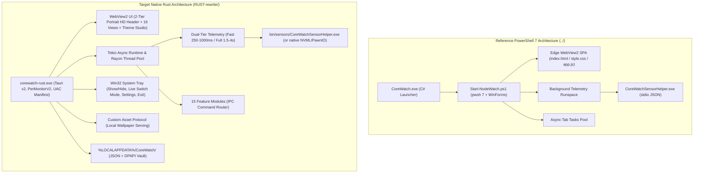
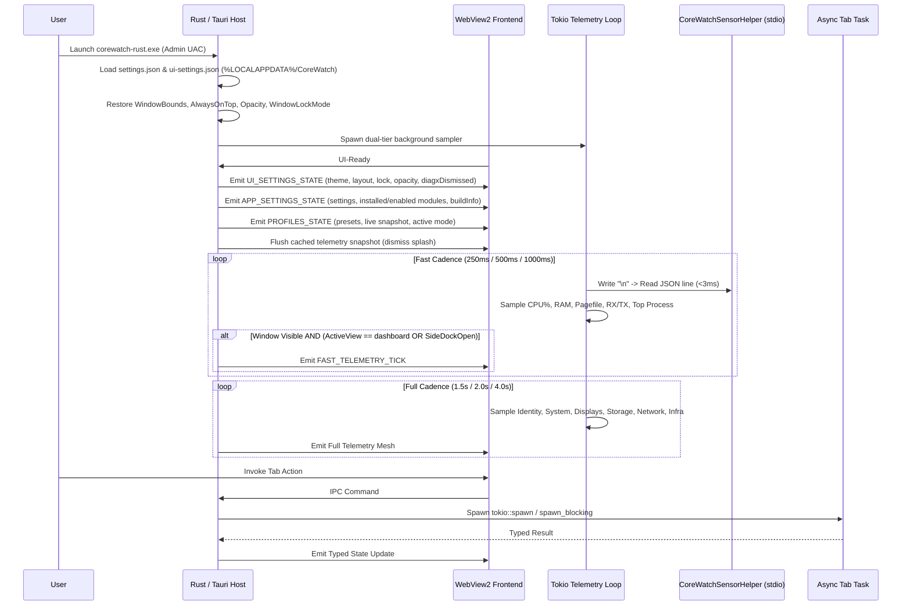

# CoreWatch Host Engine — Complete Architecture & Rust Rewrite Specification

> **Purpose**: Ground-truth engineering specification of **CoreWatch Host Engine** (`v0.9.2-beta`, ~28,000+ LOC across PowerShell 7, C#/.NET, and WebView2 HTML/CSS/JS), tailored to guide the ongoing **Tauri v2 Rust rewrite** inside `RUST-rewrite/` to 100% functional parity.

---

## 1. Current `RUST-rewrite` Prototype vs. CoreWatch `v0.9.2-beta` Parity Matrix

The existing `RUST-rewrite/` project (`tauri = "2"`, `windows = "0.62"`, `windows-sys = "0.61"`, `sysinfo = "0.39"`, `wmi = "0.18"`, `winreg = "0.56"`) already has a strong foundation. Here is the exact parity map:

| Subsystem / Module | PowerShell Reference (`../`) | Current `RUST-rewrite/` Status | Remaining Work for Full Parity |
|---|---|---|---|
| **Dashboard Core Telemetry** | `modules/telemetry/*.ps1` | **Implemented** (`fast.rs`, `details.rs`, `sensors.rs`, `native.rs`) | Add Top Process kill strip, Polling Profile (`fast`/`balanced`/`eco`), `°C`/`°F` unit preference, Side Pop-Out Telemetry Dock, drag-reorder/width/collapse layout persistence. |
| **Display Control & Identify** | `GetDisplayMetrics.ps1` | **Implemented** (`display_control.rs`, `identify.html`) | Add native CCD DPI Scale (`DISPLAYCONFIG_SOURCE_DPI_SCALE_SET`) and direct CloudStore Night Light toggle + warmth % slider (currently opens Windows Settings). |
| **Network Manager & Diagnostics** | `NetworkManager.ps1`, `NetworkDiagnostics.ps1`, `NetworkTest.ps1` | **Implemented** (`network.rs`, `network_test.rs`) | The dashboard shows IPv4 DNS for the lowest-cost active IPv4 default route. It provides Quick DNS presets, a cache flush with a live DNS probe, gateway neighbor refresh, and elevated physical adapter toggles. The lookup runs on demand. |
| **Window Shell, Lock & Tray** | `Start-NodeWatch.ps1` | **Partial** (`main.rs`) | Add **3-State Window Lock** (`none`/`position`/`all`), **System Tray** with live *Switch Mode* submenu, **Always on Top**, **Window Opacity**, persisted `windowBounds`, **Adaptive 2-Tier Portrait HD (`1080×1920`) Header**, and `Ctrl+K` Command Palette. |
| **Unified Settings & DPAPI Vault** | `CoreWatchSettings.ps1`, `modules-catalog.json` | **Not Yet Ported** | Implement `settings.json`, `ui-settings.json`, `secrets.dat.json` (DPAPI `CryptProtectData`/`CryptUnprotectData`), Task Scheduler auto-start, GitHub Release self-update check, and 15-module enable/disable registry. |
| **Live Theme & Appearance Studio** | `index.html`, `style.css`, `app.js` | **Not Yet Ported** | Implement draggable floating Theme Studio popup, 10 built-in presets, 12 live CSS variables (`--cw-*`), 51 protected functional color rules, and local host wallpaper protocol (`corewatch-local://` with Cover/Stretch/Center/Contain/Tile, opacity, blur, fade/vignette, card translucency). |
| **System Profiles & Modes** | `ProfilesManager.ps1` | **Not Yet Ported** | Port Core 5 presets + custom profiles, native WNF Do Not Disturb (`0x0D83063EA3BF1C75`), Power Plan, `SetThreadExecutionState` Keep Awake, Night Light, per-monitor overrides, baseline capture & 1-click revert. |
| **Tasks, Services & Ports** | `TasksPortsManager.ps1` | **Not Yet Ported** | Live processes + kill/locate, SCM Windows services + auto-stopped fault filter, `GetExtendedTcpTable`/`GetExtendedUdpTable` sockets. |
| **UltimaDiagX** | `UltimaDiagX.ps1` | **Not Yet Ported** | 10-channel `EvtQuery` scanner, 0–100 stability score, BSOD/WER minidump detector, Mark Solved/Dismiss persistence, error code translator, external log ingestion, report export. |
| **GitHub Manager** | `GitHubManager.ps1` | **Not Yet Ported** | `gh` CLI / DPAPI PAT auth, local Git repo scanner + VS Code/Terminal/Explorer/Pull/Publish shortcuts, browse & clone own repos + Clone Any Git URL, GitHub Releases CRUD + auto-notes + asset upload. |
| **Jira Manager** | `JiraManager.ps1` | **Not Yet Ported** | Jira Cloud (REST v3) & Data Center (REST v2) auth + DPAPI token, presets + JQL, ADF ↔ Plain Text converter, transitions, comments, worklogs, assign to me, copy branch, create issue. |
| **WSL Manager** | `WslManager.ps1` | **Not Yet Ported** | Distro inventory + VHDX footprint, online catalog, deploy/launch/terminate/unregister, import/export `.tar`/`.vhdx`, VHDX compact, `.wslconfig` editor, diagnostic runner. |
| **Security & Repair Toolkit** | `SecurityRepairManager.ps1` | **Not Yet Ported** | BitLocker/TPM/Secure Boot/RDP/Scheduled Tasks, Env/Hosts/Proxy/KBs audit, DISM/SFC/WU/Winsock/Temp repair actions, 1-click IT Support Bundle ZIP. |
| **Startup, Sharing, Apps, Store, DiskMap, Devices, Organizer** | `StartupManager.ps1`, `SharingManager.ps1`, `InstalledAppsManager.ps1`, `AppInstallerManager.ps1`, `DiskMapper.ps1`, `DeviceManager.ps1`, `FileOrganizer.ps1` | **Partial** (`devices.rs` started) | Port remaining 7 System tabs (`DiskMap` with `jwalk`/`rayon` will be 20–50× faster in Rust!). |

---

## 2. System Architecture & Runtime Dataflow

### Startup & Dual-Tier Telemetry Sequence

> **Startup Invariant**: Never pause telemetry from early `Resize` events fired before the window is first shown (`Visible == false`). Gate pause/resume strictly after initial `Shown` / visibility confirmation, and always resume on `VisibleChanged` and `UI-Ready`.

---

## 3. Windowing, DPI, 3-State Window Lock & Adaptive Header

### 3-State Window Lock Machine

```mermaid
stateDiagram-v2
    [*] --> none : Default (Unlocked)
    none --> position : 1st Click on Lock Button
    position --> all : 2nd Click on Lock Button
    all --> none : 3rd Click on Lock Button

    state none {
        [*] --> Unlocked : Icon 🔓 — Move, Maximize, All 8 Resize Edges Allowed
    }
    state position {
        [*] --> PositionLocked : Icon 🔒 — Move & Maximize Blocked; Only Right(11), Bottom(15), BottomRight(17) Resize Allowed
    }
    state all {
        [*] --> FullyLocked : Icon 🔐 — Move, Maximize & All 8 Resize Edges Blocked
    }
```

### Adaptive 2-Tier Header (`1080×1920` Portrait HD & Narrow Windows)
- **`≥ 1380px`**: Single-row header (`Left: Brand + Ctrl+K`, `Center: Tabs`, `Right: Mode Pill + Utility Icons + Exit`).
- **`≤ 1379px` (Portrait HD `1080×1920`)**: Splits via CSS Flexbox `order` into **Row 1** (Brand + Ctrl+K + drag grip + Mode Pill + Dock + Layout + `🎨` Theme + `🔓` Lock + `📌` Pin + `⚙️` Settings + `⏻` Exit) and **Row 2** (full-width `flex-wrap: wrap` navigation tabs: `Dashboard`, `Network`, `Tasks & Ports`, `UltimaDiagX`, `💻 Dev & Work ▾`, `🧰 System ▾`).
- **`≤ 760px` / `≤ 560px`**: Secondary labels hide cleanly to compact icon buttons, tabs wrap naturally with zero horizontal overflow, and dropdown menus clamp inside viewport bounds.

---

## 4. Complete Feature Inventory (All 16 Views)

### Core View 0: System Overview Dashboard (`core`)
- **⚡ Hardware Metrics**: CPU model/load/clock/temp/throttle/L1-L3 cache; GPU model/load/driver/power/temp/VRAM; RAM & Pagefile; **Top Process** strip with click-to-end.
- **🖥️ Display & Monitors**: Per-monitor resolution, Hz switcher, DPI scale switcher (`100%–250%`), orientation (`0/90/180/270°`), HDR toggle, Night Light toggle + warmth %, **Identify Monitors** topmost overlay badges.
- **💾 Storage & Volumes**: Local/removable drives, media type (NVMe/SSD/HDD), usage bars, click to open Explorer, inline volume label rename.
- **🌐 Network Matrix & Traffic**: Active uplink details, Quick DNS switcher (Auto/Cloudflare/Google/Quad9/Custom), Flush & Probe DNS, Gateway ARP refresh, Public IP lookup, Wired/Wi-Fi enable/disable badges, live RX/TX throughput bar, Speed/Jitter/Packet Loss test (`Test Mesh`).
- **🛡️ Infrastructure & System Health**: OS/build/uptime, hostname/workgroup rename, Power Plan switcher, Pending Reboot badge/reboot trigger, Telemetry/Firewall/Defender (Tamper, Real-Time, Behavior, Cloud, IOAV)/Discovery/Sharing/NetProfile toggles, Java `JAVA_HOME`/PATH switcher, PawnIO status & installer. *(Note: PowerShell 7 update badge is no longer required for runtime once fully on Rust, though it can remain an optional dev-runtime check if desired!)*
- **📟 Live Diagnostic Console**: Timestamped activity log with Clear button.
- **Layout Customization**: Drag-reorder cards, half/full width toggle, collapse, hide individual cards or metrics, and **Side Pop-Out Telemetry Dock**.

### The 15 Optional Modular Tabs (see [`modules-catalog.json`](./modules-catalog.json))
1. **`netmanager`** *(Top)*: Adapter IPv4/DHCP/DNS/Enable/Disable/Restart/Rename + Active Diagnostics (Ping, Traceroute, TCP Port Test, DNS Lookup) + Wi-Fi RSSI, Routing Table & ARP Cache.
2. **`tasksports`** *(Top)*: Live Processes (sort/filter/kill/open path), Windows Services (auto-stopped fault filter, Start/Stop/Restart/StartupType), Listening & Established TCP/UDP Sockets mapped to owning PID.
3. **`diagx`** *(Top)*: 10-channel Windows Event Log analyzer, 0–100 Stability Score, BSOD/WER minidump detector, recurring fault clustering, Mark Solved/Dismiss (epoch-aware auto-re-alert), Error/BugCheck Code Translator, external log ingestion, report export.
4. **`github`** *(Dev & Work)*: `gh` CLI or DPAPI PAT auth, local Git project scanner + VS Code/Terminal/Explorer/Pull/Publish shortcuts, browse & clone own repos + Clone Any Git URL with destination/branch/shallow/VS Code options, GitHub Releases CRUD + auto-generated notes + asset upload.
5. **`jira`** *(Dev & Work)*: Jira Cloud (REST v3) & Server/Data Center (REST v2) auth + DPAPI token, presets (Assigned/Open/Reported/Recent/Custom JQL) + Project filter, ADF ↔ Plain Text converter, live workflow transitions, comments, worklog time logging, Assign to Me, Copy Git Branch, Create Issue modal.
6. **`wsl`** *(Dev & Work)*: Installed distros + VHDX sizes + `vmmemWSL` RAM, online catalog, install/update engine, deploy/launch/terminate/unregister, WSL1↔2 convert, `.tar`/`.vhdx` import/export, VHDX compaction, `.wslconfig` editor, diagnostic shell runner.
7. **`profiles`** *(System)*: 5 built-in presets (*Normal*, *Work*, *Gaming*, *Presentation*, *Night*) + custom profiles + Capture Current PC + 1-click Revert + JSON Export/Import; controls WNF Do Not Disturb, Power Plan, Keep Screen Awake, Night Light + warmth %, and per-monitor HDR/Hz/Scale.
8. **`security`** *(System)*: BitLocker/TPM/Secure Boot/UAC/RDP/Scheduled Tasks posture, Env/Hosts/Proxy/KBs audit, DISM/SFC/WU/Winsock/BatteryReport/Safe Temp repair toolkit, 1-click IT Support Bundle ZIP.
9. **`startup`** *(System)*: Boot Registry (`Run`/`RunOnce`/`StartupApproved`) & Startup folders — inspect, enable/disable, add, delete, open location.
10. **`sharing`** *(System)*: SMB shares & ACL permissions — create, remove, delete folder, grant/revoke `Read`/`Change`/`Full`.
11. **`apps`** *(System)*: Installed software inventory (64/32-bit Registry + Appx), on-demand folder size calculator, uninstall/modify, open folder/registry, cross-drive **App Mover** (robocopy + NTFS junction).
12. **`appstore`** *(System)*: Curated 30+ app catalog (including ArtCraft Launcher & PawnIO), WinGet live search, batch install/upgrade, and **App Launcher** (`▶ Launch` resolving Start Menu `.lnk` / `App Paths` / `InstallLocation`).
13. **`diskmap`** *(System)*: Multithreaded WizTree-style visual storage treemap, Top-N largest files, exact extension breakdown, Explorer reveal, Recycle Bin delete.
14. **`devices`** *(System)*: PnP hardware tree, driver age/version & `CM_PROB_*` diagnostics, Enable/Disable/Restart, open `.inf`, native `devmgmt.msc`, vendor driver links.
15. **`organizer`** *(System)*: Rule-based folder file sorter with dry-run preview and 1-click undo log.

---

## 5. Companion Support Documents in `RUST-rewrite/docs/`

- [`WINDOWS-NATIVE-APIS.md`](./WINDOWS-NATIVE-APIS.md) — Exact Win32/NT/WNF/CCD/CloudStore/DPAPI/Sensor Helper structs, constants, and byte layouts.
- [`IPC-AND-SCHEMAS.md`](./IPC-AND-SCHEMAS.md) — Exact `%LOCALAPPDATA%\CoreWatch\` JSON schemas, Theme Studio schema, full IPC command catalog, and Day-1 Tauri bridge shim.
- [`modules-catalog.json`](./modules-catalog.json) — Machine-readable 15-module catalog and installer presets.
- [`AGENT-HANDOFF-PROMPT.md`](./AGENT-HANDOFF-PROMPT.md) — Ready-to-use agent brief, build/verify commands, and phased implementation checklist.
